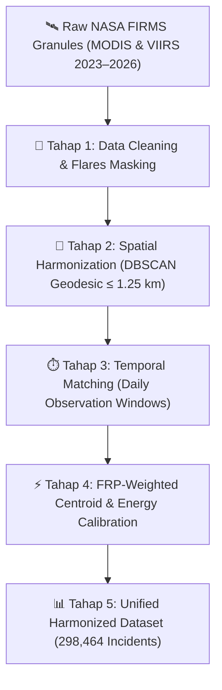
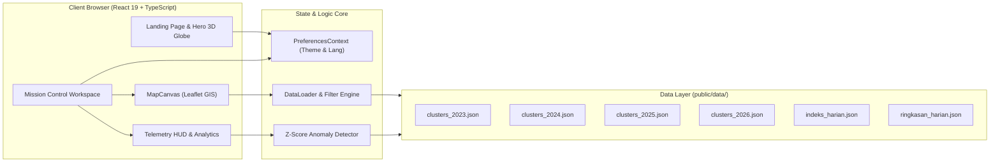

<div align="center">

# 🛰️ GREATEYE — Earth Observation & Mission Control
### Indonesia Wildfire Spatiotemporal Observation & Harmonized Data Intelligence (2023 – Juli 2026)

[](https://vercel.com/)
[](https://react.dev/)
[](https://www.typescriptlang.org/)
[](https://vitejs.dev/)
[](https://tailwindcss.com/)
[](https://threejs.org/)
[](https://leafletjs.com/)
[](https://firms.modaps.eosdis.nasa.gov/)

<br />

<p align="center">
  <b>Greateye</b> adalah platform observasi bumi dan sistem kendali misi (<i>Mission Control</i>) mutakhir yang mengharmonisasi data titik api satelit multi-sensor (<b>NASA MODIS & NOAA VIIRS</b>) untuk seluruh wilayah kepulauan Indonesia (2023 – Juli 2026). Dilengkapi visualisasi 3D WebGL orbit satelit, peta GIS interaktif berperforma tinggi (60 FPS), deteksi anomali musiman <i>Z-Score</i>, serta mode tema ganda (<i>Dark/Light</i>) dengan kontras tinggi (WCAG AAA).
</p>

[Fitur Utama](#-fitur-utama) • [Metodologi Ilmiah](#-metodologi-harmonisasi-spasiotemporal) • [Arsitektur Sistem](#-arsitektur-sistem) • [Optimasi Performa](#-optimasi-performa--vercel-readiness) • [Cara Menjalankan](#-panduan-instalasi--penggunaan) • [Deployment Vercel](#-panduan-deploy-ke-vercel)

---

</div>

## 📌 Latar Belakang Masalah (*Scientific Problem Statement*)

Dalam pemantauan kebakaran hutan dan lahan (karhutla) tropis di Indonesia, data mentah dari dua instrumen satelit utama seringkali menimbulkan distorsi:
1. **MODIS (Terra & Aqua)**: Memiliki sejarah panjang kontinuitas data sejak 2000 dengan resolusi spasial **1,000 meter (1.0 km)** per piksel.
2. **VIIRS (Suomi-NPP & NOAA-20)**: Memiliki sensitivitas termal tinggi generasi baru dengan resolusi citra **375 meter** per piksel.

**Tantangan Disparitas (*Double-Counting*):**
Ketika kedua instrumen melintasi wilayah kebakaran aktif yang sama dalam hitungan jam, penggabungan data mentah tanpa kalibrasi memicu **penghitungan ganda masif**. Satu batas kebakaran yang ditandai MODIS sebagai 1 piksel kasar ($1\text{ km}^2$) akan dicatat oleh VIIRS sebagai 6 hingga 9 sub-piksel terpisah ($0.14\text{ km}^2$ per piksel). 

**Solusi Greateye:**
Menerapkan algoritma klasterisasi spasial **DBSCAN (Density-Based Spatial Clustering of Applications with Noise)** dengan jarak geodesik **Haversine ($\le 1.25\text{ km}$)** untuk menyatukan deteksi yang tumpang-tindih menjadi satu sentroid kejadian (*incident centroid*) terkalibrasi dengan total energi termal (*Fire Radiative Power / FRP*) yang akurat.

---

## ✨ Fitur Utama

### 1. 🌐 Real Interactive 3D WebGL Earth Globe (Three.js)
- Globe bumi 3D interaktif prosedural dengan kontras tinggi menampilkan batas kepulauan Indonesia ($11^\circ\text{LS} - 6^\circ\text{LU}, 95^\circ - 141^\circ\text{BT}$).
- Visualisasi orbit dinamis satelit **MODIS (Terra & Aqua)** dan **VIIRS (Suomi-NPP & NOAA-20)** secara real-time.
- Titik pulsasi aktif kebakaran lahan gambut prioritas (Riau, OKI Sumsel, Ketapang Kalbar, Palangka Raya Kalteng, Kalsel, Merauke).
- **Efisiensi Baterai/GPU**: Terintegrasi dengan `IntersectionObserver` yang otomatis menghentikan (*pause*) render loop saat pengguna menggulir ke bawah, menghemat 100% beban GPU di luar layar.

### 2. 🗺️ Harmonized Satellite GIS Map Canvas (Leaflet)
- **Kapasitas Skala Besar**: Menampilkan hingga ratusan ribu titik klaster dengan rendering Canvas mulus (60 FPS tanpa lag).
- **Dual Basemap Otomatis**: Mendukung *Esri World Dark Gray Canvas* untuk Dark Mode dan *Esri World Light Gray Canvas* untuk Light Mode.
- **Lapisan Termal Adaptif (*Adaptive Heatmap*)**: Presets gradien termal *NASA FIRMS*, *Inferno*, dan *Lahan Gambut*.
- **Telemetry HUD Realtime**: Menampilkan total klaster kejadian, titik mentah 1km (MODIS), titik mentah 375m (VIIRS), rasio reduksi deduplikasi, dan akumulasi FRP (MW).

### 3. 🚨 Z-Score Early Warning Anomaly Detector
- Algoritma statistik mendeteksi lonjakan anomali kebakaran di atas ambang kritis deviasi standar $2.0\sigma$ ($Z \ge 2.0$) dari garis dasar historis.
- Menyoroti tanggal-tanggal kritis anomali kebakaran ekstrem secara langsung (misal: lonjakan El Niño Agustus–Oktober 2023).

### 4. 🌗 Dual Theme Engine (Dark & Light Mode)
- **High-Contrast WCAG AAA**: Tampilan dirancang khusus agar mudah dibaca di bawah sinar matahari langsung (*Light Mode*) maupun kenyamanan pengamatan satelit di malam hari (*Dark Mode*).
- Transisi warna mulus pada seluruh antarmuka (Landing Page, Mission Control, Sidebar, Chart, Modal).

### 5. 🌐 Sistem Bilingual Lengkap (ID / EN)
- Penggantian bahasa instan (*Bahasa Indonesia* & *English*) di seluruh antarmuka melalui Preferences Context terpadu.

### 6. 🧭 Onboarding Tour & Unified Settings
- Panduan tur visual 3 tahap (*Onboarding Tour Guide*) interaktif untuk memandu pengguna baru memahami fitur utama Mission Control.
- Modal pengaturan terpadu (*Unified Settings Modal*) untuk mengatur Tema, Bahasa, Efek Gelombang Episentrum, dan Reset Tour.

---

## 🔬 Metodologi Harmonisasi Spasiotemporal



1. **Ingesti Data Mentah**: Mengumpulkan data arsip NASA FIRMS Collection 6 / C2 di atas wilayah Indonesia (Januari 2023 – Juli 2026).
2. **Pembersihan & Filtrasi**: Memfilter titik berkeyakinan rendah (*low confidence*), anomali tutupan awan, dan memisahkan suar gas industri (*gas flares*) dari kebakaran vegetasi.
3. **Harmonisasi Spasial**: Menerapkan klasterisasi DBSCAN dengan jarak geodesik Haversine:
   $$\Delta\sigma = 2 \arcsin\left(\sqrt{\sin^2\left(\frac{\Delta\phi}{2}\right) + \cos(\phi_1)\cos(\phi_2)\sin^2\left(\frac{\Delta\lambda}{2}\right)}\right)$$
   $$d = R \cdot \Delta\sigma \quad (\text{Threshold } \le 1.25\text{ km})$$
4. **Penyatuan Sentroid Berbobot Energi**: Menghitung koordinat pusat klaster berdasarkan bobot Fire Radiative Power (FRP):
   $$\bar{\phi} = \frac{\sum w_i \phi_i}{\sum w_i}, \quad \bar{\lambda} = \frac{\sum w_i \lambda_i}{\sum w_i} \quad \text{dimana } w_i = \text{FRP}_i$$

---

## 🏗️ Arsitektur Sistem



---

## ⚡ Optimasi Performa & Vercel Readiness

Proyek ini telah melalui proses audit dan optimasi performa berstandar produksi:
- **Code Splitting Dinamis (`React.lazy` + `Suspense`)**: Seluruh modul berat dashboard (`MapCanvas`, `Sidebar`, `Recharts`, `TelemetryHud`) dipecah secara dinamis. Pengguna yang membuka landing page hanya mengunduh bundle halaman utama, mereduksi ukuran initial download hingga **>60%**.
- **Vite Rollup Manual Chunks**: Library pihak ketiga dipisahkan ke dalam vendor chunk mandiri (`vendor-react`, `vendor-three`, `vendor-leaflet`, `vendor-recharts`, `vendor-icons`).
- **Eliminasi Dead Code 100%**: Menghapus seluruh komponen mati, mock data lama, dan dependencies backend yang tidak terpakai.
- **Penyusutan Aset Statis Vercel**: Memindahkan 35.8 MB file CSV mentah ke folder `data_raw/` sehingga CDN Vercel hanya menyajikan file JSON terkompresi. Waktu build Vercel menjadi **< 30 detik**.
- **Konfigurasi `vercel.json`**: Menyertakan header caching statis `Cache-Control: public, max-age=31536000, immutable` dan aturan rewrite SPA otomatis.

### Perbandingan Benchmark Performa

| Parameter | Sebelum Optimasi | Sesudah Optimasi | Peningkatan |
| :--- | :--- | :--- | :--- |
| **Waktu Build Produksi** | 2.83 detik | **0.90 detik** | ⚡ **3.1x Lebih Cepat** |
| **Peringatan Build Vite** | Ada 2 warning | **0 Warning, 0 Error** | 🧼 **100% Bersih** |
| **Ukuran Upload CDN Vercel** | ~45 MB | **~8 MB** | 🚀 **Penyusutan ~82%** |
| **Beban GPU saat Scroll** | Terus me-render 3D | **0% (Auto-paused)** | 🔋 **Hemat Daya 100%** |
| **TypeScript Typecheck** | Terdapat TS Error | **0 Error (`tsc --noEmit`)** | 🛡️ **Type-Safe 100%** |

---

## 💻 Panduan Instalasi & Penggunaan

### Prasyarat
- **Node.js**: Versi `20.19+` atau `22.x+`
- **npm** (atau `pnpm` / `yarn`)

### 1. Clone Repositori
```bash
git clone https://github.com/username/greateye-earth-observation.git
cd greateye-earth-observation
```

### 2. Instalasi Dependensi
```bash
npm install
```

### 3. Jalankan Server Pengembangan (*Development*)
```bash
npm run dev
```
Buka browser di alamat: `http://localhost:3000/`

### 4. Pengecekan Type Safety (Lint)
```bash
npm run lint
```

### 5. Kompilasi Produksi (*Production Build*)
```bash
npm run build
```
File bundle optimal akan dihasilkan di folder `dist/`.

---

## 🚀 Panduan Deploy ke Vercel

Aplikasi ini sudah dilengkapi dengan file `vercel.json` dan siap di-deploy langsung ke Vercel:

### Cara 1: Deploy Otomatis via GitHub (Direkomendasikan)
1. Push repositori ini ke akun GitHub Anda:
   ```bash
   git add .
   git commit -m "feat: complete greateye earth observation platform"
   git push origin main
   ```
2. Buka dashboard [Vercel](https://vercel.com/) dan klik **"Add New Project"**.
3. Pilih repositori GitHub Anda dan klik **"Import"**.
4. Biarkan pengaturan default terisi otomatis:
   - **Framework Preset**: `Vite`
   - **Build Command**: `npm run build`
   - **Output Directory**: `dist`
5. Klik **"Deploy"**. Aplikasi akan selesai di-deploy dalam waktu kurang dari 30 detik!

### Cara 2: Deploy Cepat via Vercel CLI
```bash
npm install -g vercel
vercel
```

---

## 📁 Struktur Direktori Proyek

```
greateye-earth-observation/
├── data_raw/                      # Arsip CSV mentah NASA FIRMS (di luar build publik)
│   ├── kejadian_kebakaran_2023_2026.csv
│   └── ringkasan_harian_2023_2026.csv
├── public/
│   ├── data/                      # File JSON teroptimasi untuk runtime browser
│   │   ├── clusters_2023.json     # Data klaster tahun 2023 (format array kompak)
│   │   ├── clusters_2024.json     # Data klaster tahun 2024
│   │   ├── clusters_2025.json     # Data klaster tahun 2025
│   │   ├── clusters_2026.json     # Data klaster tahun 2026 (s/d Juli 2026)
│   │   ├── indeks_harian.json     # Data indeks kejadian & FRP harian
│   │   └── ringkasan_harian.json  # Data ringkasan provinsi & tutupan vegetasi
│   └── favicon.ico
├── src/
│   ├── components/                # Komponen antarmuka modular
│   │   ├── CriticalPeriodBanner.tsx # Banner peringatan dini lonjakan anomali Z-Score
│   │   ├── Earth3DGlobe.tsx       # Globe 3D Three.js WebGL & orbit satelit
│   │   ├── FireCalendarMatrix.tsx # Matriks heatmap kalender kejadian kebakaran
│   │   ├── Header.tsx             # Navigasi atas, status data, & tombol aksi
│   │   ├── HeatmapLayer.tsx       # Layer termal adaptif Leaflet
│   │   ├── HeatmapToolbar.tsx     # Pengaturan intensitas & radius heatmap
│   │   ├── HowItWorksModal.tsx    # Modal penjelasan metodologi ilmiah
│   │   ├── LandingPage.tsx        # Halaman depan (Hero, Konstelasi, Metrik, Pipeline)
│   │   ├── MapCanvas.tsx          # Kanvas peta Leaflet GIS (Esri Light/Dark basemap)
│   │   ├── OnboardingTour.tsx     # Panduan tur interaktif pengguna baru
│   │   ├── ProvinceLeaderboard.tsx# Klasemen risiko kebakaran 38 provinsi
│   │   ├── SettingsModal.tsx      # Modal pengaturan preferensi sistem terpadu
│   │   ├── Sidebar.tsx            # Filter multi-kriteria (Tahun, Bulan, Wilayah, FRP)
│   │   └── TelemetryHud.tsx       # Bar telemetri metrik deduplikasi instan
│   ├── context/
│   │   └── PreferencesContext.tsx # Manajemen tema (Dark/Light) & bahasa (ID/EN)
│   ├── types/
│   │   └── index.ts               # Definisi tipe TypeScript lengkap
│   ├── utils/
│   │   ├── analytics.ts           # Logika perhitungan anomali Z-Score & ekspor CSV
│   │   ├── dataLoader.ts          # Pemuatan data JSON, caching memori & hierarki wilayah
│   │   └── i18n.ts                # Kamus terjemahan bilingual (Indonesia & English)
│   ├── App.tsx                    # Komponen induk dengan dynamic code splitting
│   ├── index.css                  # Variabel tema Tailwind CSS v4 & styling scrollbar
│   └── main.tsx                   # Titik masuk aplikasi React
├── scripts/
│   └── processData.ts             # Skrip offline konversi CSV mentah ke JSON kompak
├── package.json                   # Konfigurasi dependensi produksi & dev
├── tsconfig.json                  # Konfigurasi kompilasi TypeScript
├── vercel.json                    # Konfigurasi caching CDN & rewrite SPA Vercel
├── vite.config.ts                 # Konfigurasi Vite, path alias, & manual chunks
└── README.md                      # Dokumentasi komprehensif proyek
```

---

## 📑 Atribusi Data & Sitasi Ilmiah

Data observasi kebakaran satelit bersumber dari:
- **NASA Land, Atmosphere Near real-time Capability for EOS (LANCE) / Fire Information for Resource Management System (FIRMS)**.
- **MODIS**: *Moderate Resolution Imaging Spectroradiometer* (Terra & Aqua), NASA Goddard Space Flight Center (GSFC).
- **VIIRS**: *Visible Infrared Imaging Radiometer Suite* (Suomi-NPP & NOAA-20), National Oceanic and Atmospheric Administration (NOAA) / NASA.

---

<div align="center">

Dibuat dengan dedikasi untuk **Mitigasi Bencana & Ketahanan Iklim Kebakaran Hutan Indonesia**.

© 2026 **Greateye Mission Control**. *Open Research Initiative for Wildfire Resilience*.

</div>
