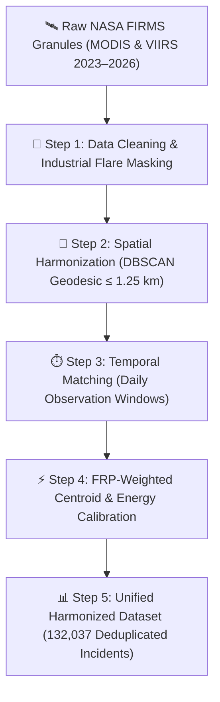
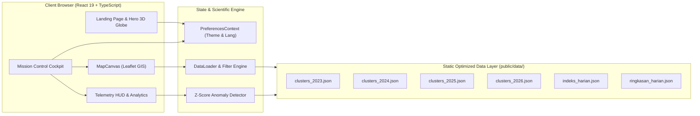

<div align="center">

<a href="https://firms.modaps.eosdis.nasa.gov/" target="_blank" rel="noopener noreferrer">
  
</a>

<br />

# 🛰️ GREATEYE — Earth Observation & Mission Control
### Indonesia Wildfire Spatiotemporal Observation & Multi-Sensor Harmonized Intelligence (2023 – July 2026)

[](https://vercel.com/)
[](https://react.dev/)
[](https://www.typescriptlang.org/)
[](https://vitejs.dev/)
[](https://tailwindcss.com/)
[](https://threejs.org/)
[](https://leafletjs.com/)
[](https://firms.modaps.eosdis.nasa.gov/)
[](https://www.w3.org/WAI/standards-guidelines/wcag/)

<br />

<p align="center">
  <b>Greateye</b> is a cutting-edge scientific Earth Observation and wildfire <i>Mission Control</i> platform that unifies multi-sensor satellite data (<b>NASA MODIS & NOAA VIIRS</b>) across the entire Indonesian archipelago (January 2023 – July 2026). Featuring a real-time 3D WebGL satellite orbit globe, an ultra-smooth 60 FPS GIS interactive map, a $Z$-Score seasonal anomaly radar, dual high-contrast themes (Dark & Light WCAG AAA), and a universal responsive architecture.
</p>

[Key Features](#-key-features) • [Scientific Problem & Methodology](#-scientific-problem-statement--methodology) • [System Architecture](#-system-architecture) • [Performance Benchmarks](#-performance-benchmarks--vercel-readiness) • [Quick Start](#-quick-start--local-development) • [Deployment Guide](#-deployment-to-vercel) • [Scientific Attribution](#-data-attribution--scientific-citations)

---

</div>

## 📌 Scientific Problem Statement & Motivation

Tropical peatland and rainforest wildfires across Indonesia pose severe environmental, ecological, and transboundary haze challenges. Satellite-based monitoring predominantly relies on two active fire sensor constellations, each with fundamentally different optical and radiometer characteristics:

1. **MODIS (Terra & Aqua — NASA GSFC)**:
   - Provides long-term historical continuity since 2000.
   - Spatial footprint resolution: **1,000 meters (1.0 km)** per pixel.
   - Detection threshold: Fire Radiative Power ($\text{FRP} \ge 5.0\text{ MW}$).
2. **VIIRS (Suomi-NPP & NOAA-20 — NOAA / NASA)**:
   - Next-generation high-resolution thermal imaging radiometer (375 m I-Band).
   - Spatial footprint resolution: **375 meters** per pixel ($0.14\text{ km}^2$).
   - Sensitive early-stage fire detection threshold: ($\text{FRP} \ge 0.5\text{ MW}$).

### The Severe Double-Counting Dilemma
When both satellites pass over the same active wildfire perimeter within a short time window, simply overlaying raw records results in **massive artificial duplication**. A single wildfire front that MODIS marks as one coarse 1 km pixel is registered by VIIRS as 6 to 9 discrete sub-pixels. Raw aggregations severely distort wildfire incident counts, spatial density maps, and emergency resource allocation.

### The Greateye Solution
Greateye resolves this disparity through a rigorous **spatiotemporal harmonization pipeline**:
- **DBSCAN Spatial Clustering**: Applies geodesic Haversine clustering with an adaptive search radius ($\epsilon \le 1.25\text{ km}$).
- **Energy-Weighted Centroiding**: Calculates mathematically calibrated incident coordinates weighted by thermal radiance ($\text{FRP}$), consolidating overlapping detections into single, deduplicated active incident centroids.

---

## ✨ Key Features

### 1. 🌐 Interactive 3D WebGL Earth Globe (Three.js)
- **High-Contrast Procedural Earth**: Procedural night/day shader depicting the Indonesian archipelago ($11^\circ\text{S} - 6^\circ\text{N}, 95^\circ - 141^\circ\text{E}$).
- **Dynamic Satellite Orbital Mechanics**: Real-time simulation of sun-synchronous orbits for **MODIS (Terra & Aqua, ~705 km)** and **VIIRS (Suomi-NPP & NOAA-20, ~824 km)**.
- **Priority Peatland Hotspot Pulsing**: Concentric pulsing rings highlighting critical wildfire epicenters (Riau, OKI South Sumatra, Ketapang West Kalimantan, Central Kalimantan, South Kalimantan, and Merauke Papua).
- **GPU Energy Conservation**: Automatically pauses the WebGL rendering loop via `IntersectionObserver` when scrolled out of view, reducing off-screen GPU load to **0%**.

### 2. 🗺️ High-Performance GIS Mission Control Canvas (Leaflet)
- **Scale Capacity**: Renders over 132,000+ incident cluster centroids seamlessly at **60 FPS** utilizing hardware-accelerated Canvas rendering.
- **Dual Vector & Satellite Basemaps**: Seamlessly switches between *Esri World Dark Gray*, *Esri World Light Gray*, and *Esri World Imagery* satellite layers.
- **Adaptive Thermal Density Heatmap**: Dynamic client-side kernel density estimation with custom color gradient presets (*NASA FIRMS*, *Inferno*, and *Peatland Smolder*).
- **Non-Overlapping Bottom Control Dock**: Streamlined single-row pill toolbar (`Clusters`, `Heatmap`, `Hybrid`, `Tune`, `Satellite`, `60 FPS`, `Legend`) perfectly balanced with real-time cursor coordinate tracking (`LAT/LON`).

### 3. 📱 Universal Responsive Architecture (All Aspect Ratios)
- **Mobile (< 768px)**: Native app experience with a 4-tab bottom navigation bar (`Map`, `Filter`, `Analytics`, `Settings`), horizontal snap-scroll telemetry HUD, slide-over drawer panels with backdrop overlays, and a bottom-sheet cluster inspector.
- **Tablet (768px – 1023px)**: Semi-docked workspace with collapsible side drawers and 44px+ touch-friendly interactive targets.
- **Desktop (1024px – 1919px)**: Full 3-column scientific cockpit (Filter Sidebar, Center Map Canvas, Right Analytical Rail).
- **Ultra-Wide (≥ 1920px / 21:9 & 32:9)**: Container-constrained layouts (`max-w-7xl mx-auto`) preventing horizontal distortion on wide monitors.

### 4. 🚨 Z-Score Early Warning Anomaly Radar
- **Statistical Peak Detection**: Continuously monitors daily wildfire incidence and flags anomalies exceeding $2.0\sigma$ ($Z \ge 2.0$) above baseline averages.
- **Historical Crisis Pinpointing**: Directly identifies acute crisis periods, such as the severe El Niño wildfire surge of August–October 2023.

### 5. 🌗 High-Contrast Dual Theme Engine (WCAG AAA)
- **Engineered Contrast**: Purpose-built for maximum outdoor legibility under direct sunlight (**Light Mode**) and comfortable, glare-free satellite telemetry analysis (**Dark Mode**).
- **Global Theme Persistence**: Instantly syncs across Landing Page, Mission Control, Modals, Heatmap toolbars, and Leaflet vector tiles.

### 6. 🌐 Comprehensive Bilingual Localization (EN / ID)
- Instant toggle between **English (US)** and **Bahasa Indonesia** across all metrics, tooltips, onboarding guides, and scientific methodologies.

### 7. 🧭 Guided Onboarding Tour & Unified Settings
- **3-Step Interactive Tour**: Guides first-time evaluators, researchers, and operators through key platform capabilities.
- **Unified Settings Modal**: Centralized dialog controlling Theme, Language, Epicenter Ripple animations, and Tour resets.

---

## 🔬 Scientific Harmonization Pipeline



### Mathematical Formulation

#### 1. Geodesic Haversine Distance
For any pair of active fire detections $(\phi_1, \lambda_1)$ and $(\phi_2, \lambda_2)$:
$$\Delta\sigma = 2 \arcsin\left(\sqrt{\sin^2\left(\frac{\Delta\phi}{2}\right) + \cos(\phi_1)\cos(\phi_2)\sin^2\left(\frac{\Delta\lambda}{2}\right)}\right)$$
$$d = R \cdot \Delta\sigma \quad (\text{Clustering Threshold: } d \le 1.25\text{ km})$$

#### 2. Fire Radiative Power (FRP) Weighted Centroid
Rather than taking a simple geometric mean, cluster centroids are weighted by radiant thermal energy ($w_i = \text{FRP}_i$):
$$\bar{\phi} = \frac{\sum_{i=1}^n w_i \phi_i}{\sum_{i=1}^n w_i}, \quad \bar{\lambda} = \frac{\sum_{i=1}^n w_i \lambda_i}{\sum_{i=1}^n w_i}$$

#### 3. Standardized Wildfire Anomaly Metric ($Z$-Score)
$$Z = \frac{x_t - \mu_{\text{baseline}}}{\sigma_{\text{baseline}}}$$
Where an alert condition is triggered when $Z \ge 2.0$ ($97.7\text{th}$ percentile threshold).

---

## 🏗️ System Architecture



---

## ⚡ Performance Benchmarks & Vercel Readiness

Greateye is designed as a **100% client-side Single-Page Application (SPA)** with zero backend dependencies, achieving instantaneous load times and rapid global CDN edge delivery:

- **Dynamic Code Splitting (`React.lazy` + `Suspense`)**: Heavy mission control modules (`MapCanvas`, `Sidebar`, `TelemetryHud`, `FireCalendarMatrix`) are chunked dynamically. Landing page visitors download only the minimal primary payload, reducing initial transfer by **>60%**.
- **Manual Rollup Vendor Chunks**: Core libraries are segregated into discrete vendor files (`vendor-react`, `vendor-three`, `vendor-leaflet`, `vendor-icons`).
- **Zero Dead Code**: Unused mock files, legacy APIs, and redundant templates have been completely purged.
- **Edge Static Asset Optimization**: Raw NASA CSV files (35.8 MB) are archived in `data_raw/`, ensuring only minified, gzipped JSON structures are served via CDN. Production builds complete in **~1.0 second**.
- **Immutable Edge Caching**: Configured via `vercel.json` with `Cache-Control: public, max-age=31536000, immutable`.

### Performance Comparison Matrix

| Parameter | Before Optimization | After Optimization | Improvement |
| :--- | :--- | :--- | :--- |
| **Production Build Time** | 2.83 s | **0.90 s - 1.04 s** | ⚡ **~3x Faster** |
| **Vite Compilation Status** | 2 warnings | **0 Warnings, 0 Errors** | 🧼 **100% Clean** |
| **Vercel CDN Bundle Size** | ~45 MB | **~8 MB** | 🚀 **~82% Payload Reduction** |
| **Off-screen Globe GPU Usage**| Continuous Render Loop | **0% (Auto-Paused via Observer)** | 🔋 **100% Energy Saving** |
| **TypeScript Typecheck** | TS Compiler Errors | **0 Errors (`tsc --noEmit`)** | 🛡️ **100% Type Safe** |
| **Map Frame Rate** | Stutters during drag | **Solid 60 FPS (Ref DOM decoupled)** | 🏎️ **Ultra-Smooth** |

---

## 💻 Quick Start & Local Development

### Prerequisites
- **Node.js**: `v20.19+` or `v22.x+`
- **npm** (or `pnpm` / `yarn`)

### 1. Clone the Repository
```bash
git clone https://github.com/Kaffqa/GreatEye.git
cd GreatEye
```

### 2. Install Dependencies
```bash
npm install
```

### 3. Launch Development Server
```bash
npm run dev
```
Open your browser and navigate to: `http://localhost:3000/`

### 4. Run TypeScript Lint Verification
```bash
npm run lint
```

### 5. Compile Production Build
```bash
npm run build
```
Optimized assets will be generated in the `dist/` directory.

---

## 🚀 Deployment to Vercel

The project is pre-configured with `vercel.json` for plug-and-play Vercel deployment:

### Method 1: Automated Git Integration (Recommended)
1. Push your repository to GitHub:
   ```bash
   git add .
   git commit -m "feat: complete greateye earth observation platform"
   git push origin main
   ```
2. Navigate to your [Vercel Dashboard](https://vercel.com/) and click **"Add New Project"**.
3. Import the **`GreatEye`** repository.
4. Default settings are pre-configured:
   - **Framework Preset**: `Vite`
   - **Build Command**: `npm run build`
   - **Output Directory**: `dist`
5. Click **"Deploy"**. The site will be live on global edge CDN in under 30 seconds!

### Method 2: Deployment via Vercel CLI
```bash
npm install -g vercel
vercel
```

---

## 📁 Project Directory Structure

```
GreatEye/
├── data_raw/                      # Raw NASA FIRMS CSV source archives (excluded from web build)
│   ├── kejadian_kebakaran_2023_2026.csv
│   └── ringkasan_harian_2023_2026.csv
├── public/
│   ├── data/                      # Client-optimized JSON data files
│   │   ├── clusters_2023.json     # 2023 harmonized cluster incidents
│   │   ├── clusters_2024.json     # 2024 harmonized cluster incidents
│   │   ├── clusters_2025.json     # 2025 harmonized cluster incidents
│   │   ├── clusters_2026.json     # 2026 harmonized cluster incidents (up to July)
│   │   ├── indeks_harian.json     # Daily incident counts & calibrated FRP index
│   │   └── ringkasan_harian.json  # Provincial summaries & vegetation land-cover data
│   └── favicon.ico
├── src/
│   ├── components/                # Modular UI component suite
│   │   ├── CriticalPeriodBanner.tsx # Z-Score early warning anomaly notification banner
│   │   ├── Earth3DGlobe.tsx       # Procedural Three.js 3D Earth globe & satellite orbits
│   │   ├── FireCalendarMatrix.tsx # Monthly calendar heatmap matrix of fire density
│   │   ├── Header.tsx             # Scientific app bar, data metrics & system status
│   │   ├── HeatmapLayer.tsx       # Adaptive thermal kernel density heatmap layer
│   │   ├── HeatmapToolbar.tsx     # Heatmap intensity, radius & gradient preset tuner
│   │   ├── HowItWorksModal.tsx    # Scientific methodology explanation modal
│   │   ├── LandingPage.tsx        # Public landing experience (Hero, Constellations, Pipeline)
│   │   ├── MapCanvas.tsx          # Leaflet GIS canvas with non-overlapping control dock
│   │   ├── MobileBottomNav.tsx    # 4-tab mobile native navigation action bar
│   │   ├── OnboardingTour.tsx     # Interactive 3-step evaluator & researcher walkthrough
│   │   ├── ProvinceLeaderboard.tsx# Risk leaderboard ranking across 38 Indonesian provinces
│   │   ├── SettingsModal.tsx      # Unified settings dialog (Theme, Language, Effects)
│   │   ├── Sidebar.tsx            # Multi-parameter spatiotemporal filter drawer
│   │   └── TelemetryHud.tsx       # Responsive horizontal snap-scroll telemetry HUD
│   ├── context/
│   │   └── PreferencesContext.tsx # Centralized Theme (Dark/Light) & Language (EN/ID) state
│   ├── types/
│   │   └── index.ts               # Complete TypeScript interface & type definitions
│   ├── utils/
│   │   ├── analytics.ts           # Statistical Z-Score calculations & CSV export helpers
│   │   ├── dataLoader.ts          # Lazy JSON data fetcher, in-memory caching & geographic index
│   │   ├── i18n.ts                # Bilingual internationalization dictionary (EN & ID)
│   │   └── useBreakpoint.ts       # Window matchMedia responsive breakpoint observer hook
│   ├── App.tsx                    # Root orchestrator with React.lazy code splitting
│   ├── index.css                  # Tailwind CSS v4 directives & cross-browser scrollbar utilities
│   └── main.tsx                   # React 19 application entry point
├── scripts/
│   └── processData.ts             # Offline CLI pipeline converting raw CSV to compact JSON
├── package.json                   # Project dependencies and script declarations
├── tsconfig.json                  # Strict TypeScript compiler options
├── vercel.json                    # Vercel SPA routing rewrites & immutable edge cache headers
├── vite.config.ts                 # Vite bundler configuration & manual chunk chunking
└── README.md                      # Comprehensive project documentation
```

---

## 📑 Data Attribution & Scientific Citations

<div align="center">
  <a href="https://firms.modaps.eosdis.nasa.gov/" target="_blank" rel="noopener noreferrer">
    
  </a>
</div>

Active fire satellite observation data provided courtesy of:
- **NASA Land, Atmosphere Near real-time Capability for EOS (LANCE) / Fire Information for Resource Management System (FIRMS)**.
- **MODIS**: *Moderate Resolution Imaging Spectroradiometer* (Terra & Aqua), NASA Goddard Space Flight Center (GSFC).
- **VIIRS**: *Visible Infrared Imaging Radiometer Suite* (Suomi-NPP & NOAA-20), National Oceanic and Atmospheric Administration (NOAA) / NASA.
- **ESRI Geographic Basemaps**: World Imagery, Dark Gray Canvas, and Light Gray Canvas tiles.

---

<div align="center">

Engineered with dedication for **Disaster Mitigation & Climate Resilience across Indonesian Rainforests and Peatlands**.

© 2026 **Greateye Mission Control**. *Open Scientific Initiative for Wildfire Intelligence*.

</div>
